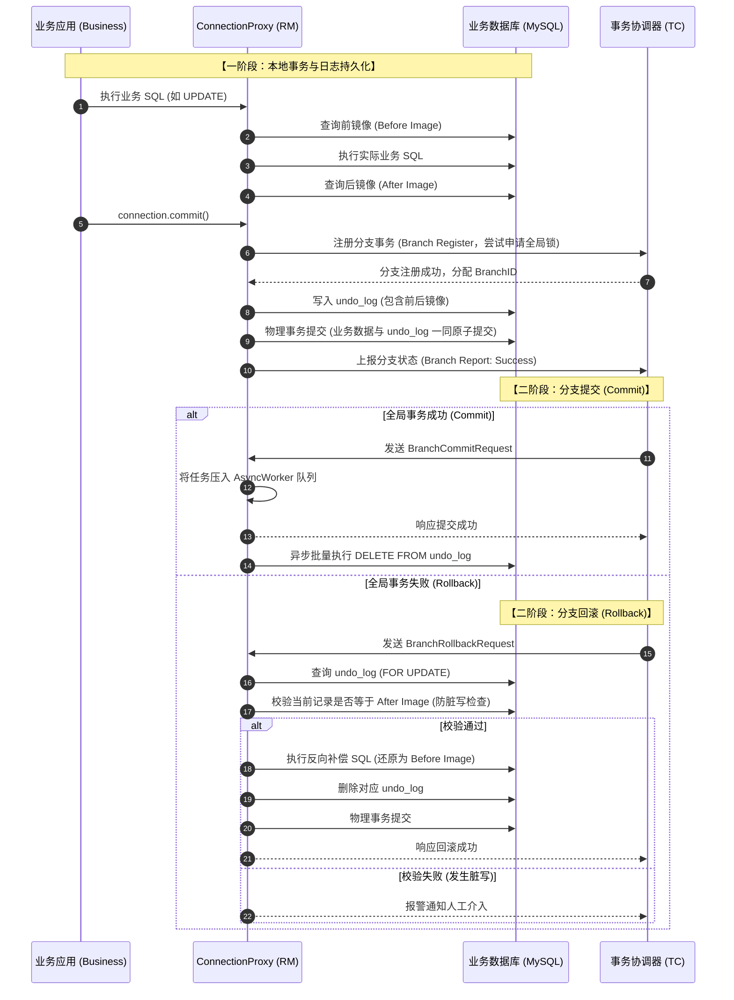

# Simple-Seata

[](LICENSE)
[](#技术栈与环境依赖)
[](https://netty.io/)
[](https://github.com/alibaba/druid)

> **轻量级、教学级分布式事务框架，提炼 Apache Seata (Fescar) 的核心精髓。**  
> 剥离生产级框架庞杂的外围包装，直击分布式事务底层两大核心命脉：**Netty 自定义二进制 RPC 通信** 与 **AT 模式（数据源代理 + 前后镜像差分 + UndoLog 反向补偿）**。

---

## 📖 项目渊源与致谢

本项目最初由国内知名微服务与分布式系统架构师 **杨波（bobo / spring2go）** 在系统性剖析分布式事务框架源码时编写并开源。其设计宗旨是通过最简洁、最凝练的代码实现，帮助开发者透彻理解 Seata（原名 Fescar）的底层设计与运行机理。

鉴于原作者原开源仓库现已下线，本项目作为一份**宝贵的源码级学习归档**予以保留和维护，供广大分布式架构爱好者研读、调试与复习。

---

## 🌟 核心特性与设计目标

- **去粗取精，专注核心**：不依赖复杂的 Spring 自动装配与庞大的微服务注册中心，代码精简直观，易于单步 Debug 跟踪。
- **无侵入 AT 模式核心闭环**：
  - 基于动态代理的 JDBC 驱动封装（`DataSourceProxy`、`ConnectionProxy`、`StatementProxy`）。
  - 基于 Druid AST 的 SQL 解析识别器（Insert / Update / Delete / SelectForUpdate）。
  - 基于前后镜像（Before Image / After Image）的脏数据检查与差异比对。
  - 基于 UndoLog 的二阶段异步批量清理与本地事务反向补偿回滚。
- **高性能长连接 RPC 通信**：
  - 基于 Netty 4 的异步双向通信架构，包含 Client / Server 模型、心跳保活机制与连接池。
  - 自定义高效二进制协议帧（魔数 `0xdada`，14 字节定长报文头，高效拆包/封包与消息合并）。
- **分布式事务上下文与 SPI 扩展**：
  - `RootContext` + `ThreadLocal` 实现全局事务 ID（`XID`）跨调用链路与线程的解耦绑定。
  - 仿照经典微内核设计的 `EnhancedServiceLoader`（SPI 机制），解耦组件装配。

---

## 🏗️ 架构分层与模块详解

项目采用清晰的多模块 Maven 结构：

```
simple-seata
├── common            # 核心公共组件：SPI 加载器、XID 全局事务 ID 生成解析、线程工厂、异常体系
├── config            # 配置中心模块：基于 Typesafe Config 的轻量化配置与变更监听体系
├── core              # 事务通信与模型：全局事务状态、Netty 自定义 RPC 通信、0xdada 二进制协议编解码
└── rm-datasource     # AT 模式核心驱动：数据源代理、Druid SQL 解析、前后镜像构建、UndoLog 管理与补偿
```

### 1. `seata-common`：基础公共组件
- **`EnhancedServiceLoader`**：微内核扩展加载器，类似于 Java 原生 SPI / Dubbo SPI，通过 `@LoadLevel` 注解按优先级动态加载实现类。
- **`XID`**：全局唯一事务标识（格式：`ip:port:transactionId`），提供静态工具方法完成生成与反解析。
- **`NamedThreadFactory`**：标准化守护线程与业务线程池创建，方便线上排查。
- **异常定义**：`FrameworkException`、`FrameworkErrorCode`、`NotSupportYetException`。

### 2. `seata-config`：配置管理
- **`Configuration`** / **`FileConfiguration`**：轻量级配置读取抽象，基于 `com.typesafe.config` 读取本地 `application.conf` 配置。
- **`ConfigChangeListener`**：支持动态配置变更监听与异步通知（`ConfigFuture`）。

### 3. `seata-core`：事务模型与 Netty RPC 通信
- **事务模型与状态机**：
  - `TransactionManager` (TM) 与 `ResourceManager` (RM) 抽象接口。
  - 全局状态 `GlobalStatus`（Begin, Committing, Rollbacking, Committed, Rollbacked 等）。
  - 分支状态 `BranchStatus` 与分支类型 `BranchType`（默认为 AT 模式）。
- **事务上下文（Context）**：
  - `RootContext`：全局门面，通过 `bind(xid)`、`unbind()`、`getXID()` 提供对全局事务状态的操作。
  - `ThreadLocalContextCore`：默认底层基于 `ThreadLocal` 维护当前执行线程绑定的全局 XID。
- **Netty RPC 通信层**：
  - `RpcServer` / `AbstractRpcRemotingServer`：服务端网络接收容器。
  - `TmRpcClient` / `RmRpcClient`：客户端通信管道，分别代表事务协调器客户端与资源管理器客户端。
  - `MessageCodecHandler`：核心编解码处理器，实现私有二进制协议。
  - `MergedWrapMessage`：支持多请求合并打包发送，降低系统调用与网络开销。

### 4. `seata-rm-datasource`：AT 模式核心实现
- **JDBC 代理层**：
  - `DataSourceProxy`：包装真实连接池（如 Druid / HikariCP），在初始化阶段自动向 RM 注册资源。
  - `ConnectionProxy`：核心拦截点。在 `commit()` 阶段完成本地事务拦截，触发分支事务注册、持久化 UndoLog 并与业务 SQL 在同一物理连接中一同提交。
  - `StatementProxy` / `PreparedStatementProxy`：拦截具体的 SQL 执行。
- **SQL 解析与识别（Druid AST）**：
  - `SQLVisitorFactory` 解析 SQL 抽象语法树（AST）。
  - 内置 MySQL 针对各种 DML 的识别器：`MySQLInsertRecognizer`、`MySQLUpdateRecognizer`、`MySQLDeleteRecognizer`、`MySQLSelectForUpdateRecognizer`。
- **镜像生成（Image Building）**：
  - `TableMetaCache`：自动读取并缓存数据库物理表的元数据（主键、列类型等）。
  - 执行业务操作前查询获取**前镜像（Before Image）**。
  - 执行业务操作后查询获取**后镜像（After Image）**。
- **回滚日志（UndoLog）**：
  - `UndoLogManager`：负责将包含前后镜像的 `BranchUndoLog` 序列化（JSON 格式）并保存至 `undo_log` 表。
  - `AsyncWorker`：二阶段提交时，异步批量删除 `undo_log`，极大提升吞吐。
  - `UndoExecutor`：二阶段回滚时，比对当前记录后镜像以防止脏写，并逆向构造补偿 SQL（Insert $\leftrightarrow$ Delete，Update 还原旧值）。

---

## ⚡ 核心原理解析

### 1. AT 模式全流程时序图

AT 模式是 Seata 最核心的无侵入式分布式事务解决方案，分为一阶段与二阶段：



---

### 2. Netty 自定义 RPC 报文结构

Seata 自定义了紧凑且高效的二进制私有协议，报文头包含 **14 字节** 的定长 Header：

```
+--+--+--+--+--+--+--+--+--+--+--+--+--+--+--+--+--+--+--+--+--+
|      Magic      |      Flag     |     Codec     |               |
|      0xdada     |     2 Bytes   |    2 Bytes    |               |
+--+--+--+--+--+--+--+--+--+--+--+--+--+--+--+--+   Message ID  |
|                                                 |    8 Bytes    |
|                                                 |               |
+--+--+--+--+--+--+--+--+--+--+--+--+--+--+--+--+--+--+--+--+--+
|                    Body Length (4 Bytes)                      |
+--+--+--+--+--+--+--+--+--+--+--+--+--+--+--+--+--+--+--+--+--+
|                         Body Content                          |
|                       (Variable Length)                       |
+--+--+--+--+--+--+--+--+--+--+--+--+--+--+--+--+--+--+--+--+--+
```

- **Magic (2 字节)**: 固定为 `0xdada`，用于快速校验合法帧。
- **Flag (2 字节)**: 控制标志位，包含：
  - `FLAG_REQUEST = 0x80`：请求/响应标识。
  - `FLAG_ASYNC = 0x40`：是否为异步消息。
  - `FLAG_HEARTBEAT = 0x20`：心跳探测消息包。
  - `FLAG_FESCAR_CODEC = 0x10`：编解码器标识。
- **Codec / Type (2 字节)**: 消息类型标识（如 `BRANCH_COMMIT`、`GLOBAL_BEGIN` 等）。
- **Message ID (8 字节)**: 全局递增的消息序列号，用于异步回调定位 `MessageFuture`。
- **Body Length (4 字节)**: 消息体数据字节长度。
- **Body Content**: 具体的消息负载。

---

## 🛠️ 快速上手与使用示例

### 1. 创建 `undo_log` 表

AT 模式依赖业务数据库中的 `undo_log` 表来保存事务回滚镜像数据，请在参与分布式事务的业务数据库中执行以下 DDL：

```sql
CREATE TABLE `undo_log` (
  `id` bigint(20) NOT NULL AUTO_INCREMENT COMMENT '自增主键',
  `branch_id` bigint(20) NOT NULL COMMENT '分支事务ID',
  `xid` varchar(100) NOT NULL COMMENT '全局事务XID',
  `rollback_info` longblob NOT NULL COMMENT '包含前后镜像的JSON反向补偿信息',
  `log_status` int(11) NOT NULL COMMENT '日志状态(0:正常; 1:防御)',
  `log_created` datetime NOT NULL COMMENT '创建时间',
  `log_modified` datetime NOT NULL COMMENT '修改时间',
  `ext` varchar(100) DEFAULT NULL COMMENT '扩展预留字段',
  PRIMARY KEY (`id`),
  UNIQUE KEY `ux_undo_log` (`xid`, `branch_id`)
) ENGINE=InnoDB DEFAULT CHARSET=utf8 COMMENT='Seata AT 模式回滚日志表';
```

### 2. 配置数据源代理

使用 `DataSourceProxy` 包装目标物理数据源（如 DruidDataSource）：

```java
import com.alibaba.druid.pool.DruidDataSource;
import io.spring2go.seata.rm.datasource.DataSourceProxy;

// 1. 初始化原始物理数据源
DruidDataSource druidDataSource = new DruidDataSource();
druidDataSource.setUrl("jdbc:mysql://127.0.0.1:3306/db_order?useUnicode=true");
druidDataSource.setUsername("root");
druidDataSource.setPassword("123456");

// 2. 包装为 Seata 数据源代理
DataSourceProxy dataSourceProxy = new DataSourceProxy(druidDataSource);

// 3. 在业务操作中使用代理数据源获取连接
Connection connection = dataSourceProxy.getConnection();
```

### 3. 编程式事务上下文透传

```java
import io.spring2go.seata.core.context.RootContext;

// 模拟上游 RPC 拦截器在接收到远程调用时绑定 XID
String xid = "192.168.1.100:8091:98234723947";
RootContext.bind(xid);

try {
    // 执行业务 SQL，此时 ConnectionProxy 会自动捕获前后镜像并记录 undo_log
    PreparedStatement ps = connection.prepareStatement("UPDATE t_order SET status = ? WHERE id = ?");
    ps.setString(1, "PAID");
    ps.setLong(2, 1001L);
    ps.executeUpdate();
    
    connection.commit(); // 提交本地事务，同时刷入 undo_log 并上报分支
} catch (Exception e) {
    connection.rollback();
} finally {
    // 事务完成或离开当前线程时解绑 XID
    RootContext.unbind();
}
```

### 4. 零配置一键运行端到端演示 (seata-examples)

项目提供了开箱即用的 H2 内存数据库端到端演练案例，无需安装 MySQL 或任何外部中间件：

```bash
# 运行全链路端到端自动化测试（覆盖 2PC 提交、反向补偿回滚与行锁冲突）
mvn test -pl examples -Dtest=EndToEndIntegrationTest

# 或运行可交互的端到端演练主程序
mvn exec:java -pl examples -Dexec.mainClass="io.spring2go.seata.examples.DemoApp"
```

该演示包含以下完整闭环：
- **内嵌 TC 引擎**：自动启动 `EmbeddedTC` 监听 8091 端口。
- **场景一（二阶段提交）**：TM 开启事务 $\to$ 扣库存与扣余额 $\to$ 一阶段持久化 `undo_log` 与申请全局锁 $\to$ 全局提交 $\to$ TC 调度 RM 异步清理 `undo_log`。
- **场景二（二阶段回滚与补偿）**：模拟业务异常 $\to$ TM 触发回滚 $\to$ TC 调度 RM 读取 `undo_log` 反向生成补偿 SQL 自动还原数据。
- **场景三（全局行锁并发互斥）**：并发修改同一行数据被全局锁拦截阻断。

---

## 💻 技术栈与环境依赖

- **语言环境**：Java 8+（支持 Java 8 / 11 / 17 / 21）
- **构建工具**：Apache Maven 3.x
- **核心依赖**：
  - **网络通信**：Netty `4.1.24.Final`
  - **SQL 解析**：Alibaba Druid `1.1.12`
  - **序列化**：Alibaba Fastjson `1.2.48`
  - **配置中心**：Typesafe Config `1.2.1`
  - **日志门面**：SLF4J `1.7.22` + Logback `1.1.6`

编译项目：

```bash
mvn clean compile
```

---

## 📚 学习与调试建议

1. **学习 Netty 协议解析**：从 `core` 模块中的 `MessageCodecHandler` 入手，观察 `0xdada` 魔数、包头解析以及半包/粘包的处理方式。
2. **学习 SQL 语法树识别**：重点阅读 `rm-datasource` 下的 `SQLVisitorFactory` 和 `MySQLUpdateRecognizer`，体会 Druid AST 如何提取 Table Name、Where 条件与更新字段列表。
3. **学习前后镜像与脏写防御**：跟踪 `AbstractDMLBaseExecutor.execute()` $\to$ `TableRecords` 的构建，以及 `UndoLogManager.undo()` 中针对当前数据与 `afterImage` 的比对逻辑。

---

## 📄 开源许可证

本项目基于 [Apache License 2.0](LICENSE) 协议开源。
